<p align="center">
  
</p>

<p align="center">
  <i>Student by day, developer after midnight. Every project below started as a problem I made for myself.</i>
</p>

<br>

```python
pavitra = {
    "based_in":   "Delhi, India",
    "by_day":     "Class 12, CBSE boards",
    "by_night":   "shipping apps, bots and browser extensions",
    "learning":   ["RAG", "LLM fine-tuning"],
    "next_stop":  "SAT and IELTS, then university abroad",
    "started_on": "Python, then the web, now a bit of everything",
    "peak_hours": "23:00 – 03:00 IST",
    "motto":      "build the thing that makes the internet cooler",
}
```

## The problem → solution ledger

My own bugs, and the fixes I wrote for them.

| The problem (my fault) | The fix (also mine) |
| :-- | :-- |
| Every Discord bot I tried did half of what my server needed | **RAVEN**: one bot for music, moderation, automod, antinuke, tickets, leveling and logs, with a web dashboard. Now in **400+ servers** with **250k+ users**.<br><sub>Python · py-cord · Lavalink · SvelteKit · Postgres · Redis</sub> |
| Filled my Mac's SSD with *something* and couldn't tell what | **[FreeMyMac](https://github.com/GWPx7Pavitra/freemymac)**: a native macOS storage manager. See where the space went and free it in a click or two.<br><sub>Swift · SwiftUI · [latest release](https://github.com/GWPx7Pavitra/freemymac/releases/latest)</sub> |
| Breathed Delhi air every day without knowing how bad it was | **[Nearfield](https://github.com/GWPx7Pavitra/nearfield)**: hyperlocal air quality and groundwater for your neighbourhood, including how many cigarettes the air equals today.<br><sub>OpenStreetMap · CPCB · CGWB · [live site](https://nearfield-preview.campuszzone.workers.dev)</sub> |
| My Discord server needed moderation, tickets and music, all in one bot | **[squarebotcogs](https://github.com/GWPx7Pavitra/squarebotcogs)**: Python cogs for automod, mod logs, tickets and music.<br><sub>Python · discord.py</sub> |
| Opened YouTube "for five minutes" | **[nightshift](https://github.com/GWPx7Pavitra/nightshift)**: a new-tab page that shows per-site screen time for Chrome and Brave, synced across browsers.<br><sub>JavaScript · browser extension</sub> |
| Boards 2027 are coming and my notes were everywhere | **[boards-2027](https://github.com/GWPx7Pavitra/boards-2027)**: a study planner with interactive chapter notes, labs, drills and an Android app.<br><sub>TypeScript · React · Node · Capacitor · [live](https://study.plagmo.art)</sub> |

**More I've built:** **CampusZone** (placement prep, college ERP and events in one platform, with dashboards for seven roles) · **spectre** (our HackerRank Orchestrate agent that checks whether deleted data is really gone) · **CoconutMcBot** (tickets and moderation for the coconutmc.net Minecraft server) · **Lyrix** (live Spotify lyrics overlay) · **Plagmo-Verse** (my own study and focus tools) · **[Cre8ivize](https://cre8ivize.com)** (site for an influencer agency) · **GWP Panel** (a local LLM gateway)

## Toolbox

<p>
  
</p>

I started with Python and bots, moved to the web, and now build native Mac apps in Swift too. I pick whatever the problem needs.

## Right now

- Learning how RAG pipelines and LLM fine-tuning actually work, by building with them
- Juggling CBSE boards and pull requests, with SAT and IELTS next
- Polishing FreeMyMac one release at a time
- Turning more of my own problems into tools other people can use

## Say hi

Up for collaborating on something meaningful, or just talking code at 2 AM.

**Discord** `x465` · **Email** [pavisj@icloud.com](mailto:pavisj@icloud.com) · **Instagram** [@xpavilyon](https://www.instagram.com/xpavilyon) / [@cosecthetha](https://www.instagram.com/cosecthetha)

<br>

<p align="center">
  
</p>
